<!-- Theme-Sensitive Header Banner -->
<picture>
  <source media="(prefers-color-scheme: dark)" srcset="readmefile/dark.svg">
  <source media="(prefers-color-scheme: light)" srcset="readmefile/light.svg">
  
</picture>

 

<!-- profile-art:start (generated by scripts/build_readme.py from profile.json; edits here are overwritten) -->

<h3><code>manny@github ~ $ ./contributions.sh</code></h3>

 
 

<h3><code>manny@github ~ $ whoami</code></h3>

<table>
<tr>
<td valign="top"></td>
<td valign="top"></td>
</tr>
</table>

<!-- profile-art:end -->

---

## About Me

I'm Emmanuel Mensah, a first-year Computer Science (Software Engineering) student at Brunel University London. My work sits at the intersection of **desktop application development**, **AI agent systems**, and **creative tooling** — I like building things that solve problems I actually run into, not just projects for a CV.

Before Brunel I studied at Newham Sixth Form College (NewVIc), where I completed a Level 3 BTEC in Computer Science and Games Development with triple-distinction grades and served as a Student Representative on the Student Council. That's where I started taking software seriously , games coursework pushed me into OOP and mobile development, and I kept building from there.

Outside of coursework, a lot of my learning comes from hobbies colliding with engineering. I edit videos in After Effects, and when I got tired of paying for upscalers that were slow or bad, I built my own in C#/WPF using Real-ESRGAN, which meant learning FFmpeg pipelines and patching MP4 metadata at the byte level because standard libraries couldn't handle my edge cases. I still use it on my own edits. That's the kind of work I enjoy most: picking a real problem and going deep enough to actually fix it.

More recently I've been building multi-agent AI systems. For the **Google Gemini Live Agent Challenge 2026**, I built a system that autonomously operates a Linux desktop to perform engineering design tasks — running CAD automation in FreeCAD, web research through Playwright with Gemini vision, and a planner module powered by Gemini 3.1 Pro that routes requests across specialist agents. Getting the agents to self-correct from errors instead of crashing was the hardest and most rewarding part.

I'm actively expanding into full-stack web development (React + FastAPI) alongside sharpening my core CS fundamentals. If you're working on anything interesting in AI agents, desktop tooling, or creative software — reach out.

---

## My Tech Stack

### Languages

### Frameworks & Libraries

### Tools & Platforms

### Concepts

`Object-Oriented Programming` · `Multi-Agent Systems` · `Computer Vision` · `Desktop Application Development` · `Video Processing` · `API Design` · `Event-Driven Architecture` · `Full-Stack Web Development` · `REST APIs` · `CI/CD`

> **NB:** This is a living document reflecting what I'm actively using and what I'm learning. Some tools are part of my daily workflow, others I'm still building fluency in. Growth is the point.

---

## Projects

### General Agent (CU) — Google Gemini Live Agent Challenge 2026
`Python` · `Google Gemini API` · `Playwright` · `FreeCAD` · `OpenCV`

A multi-agent system that autonomously operates a Linux desktop to perform engineering design tasks using Google Gemini's Computer Use API for vision-based screen control.

- **CAD Agent** — designs 3D parts in FreeCAD through menu-driven GUI interaction and Python macro execution, with dynamic error capture and self-correction
- **Research Agent** — uses Playwright and Gemini vision to search the web and extract structured data with confidence scores
- **Documentation Agent** — takes research output and generates automated reports
- **Planner Module** — powered by Gemini 3.1 Pro, routes complex requests across agents and generates step-by-step FreeCAD workflows

---

### Fook Upscaler
`C#` · `WPF` · `.NET` · `FFmpeg` · `Real-ESRGAN`

A Windows desktop tool that upscales videos using Real-ESRGAN AI models. Built because I edit video in After Effects as a hobby and existing upscalers were either too slow, too expensive, or both — so I built my own.

- Full pipeline from frame extraction to re-encoding with FFmpeg
- Custom binary patcher that fixes MP4 timescale and duration metadata directly at the byte level
- Supports both 32-bit and 64-bit atom formats

---

### Ruto Composer
`Adobe After Effects` · `ExtendScript/JavaScript`

An After Effects script that automates common composition workflows, cutting down repetitive manual work in my editing pipeline.

- Panel-based UI for streamlined access to frequently used animation and editing operations
- Lets users quickly fill in and manage layer properties across compositions

---

### Simon Swift — SwiftBot Memory Game
`Java` · `SwiftBot API` · `Raspberry Pi`

An interactive Simon Says-style memory game built for the SwiftBot robot.

- LED colour sequences, button input, difficulty progression, and a lives system
- Individual underlight control mapping colours to specific LED positions
- Celebratory robot dance animations triggered on high scores

---

### SwiftBot Zigzag Program
`Java` · `SwiftBot API` · `QR Code Input`

An OOP-based zigzag navigation program for the SwiftBot robot.

- Reads length and section count from QR codes, validates input, executes precise zigzag movements with 90-degree turns
- Path retracing using a stack data structure
- LED colour feedback for odd/even sections and full execution logging to file

---

*More projects on my [GitHub](https://github.com/mannycodes20) — thanks for stopping by.*

